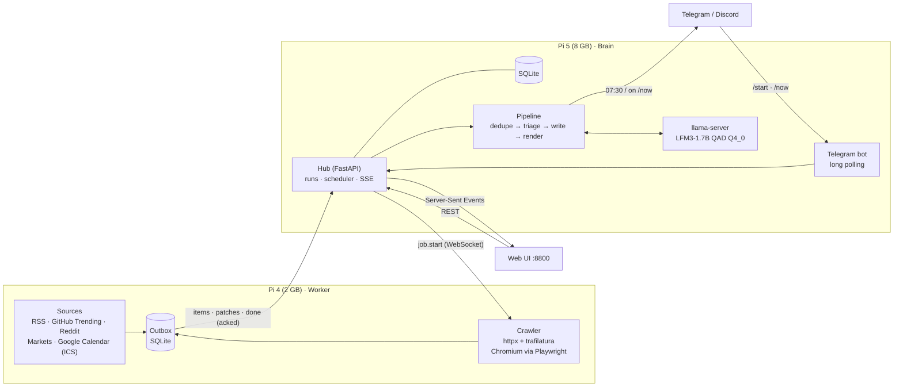

# MIB — Morning Intelligence Brief

A 24/7 personal intelligence agent on two Raspberry Pis. The Pi 4 crawls news and the web all night, the Pi 5
runs LiquidAI **LFM3-1.7B** locally to filter junk, connect stories across sources and write a concise executive
summary, delivered to Telegram (and/or Discord) every morning at 07:30 — or on demand with `/now`. A live web UI
lets you trigger news or web crawls and watch every stage happen in real time.



## Model choice: LFM3-1.7B (`LFM3-1.7B-QAD-Q4_0.gguf`)

The [LFM3 collection](https://huggingface.co/collections/LiquidAI/lfm3) has one text model (LFM3-1.7B), vision /
audio / omni variants, and two *decision* models (d1-2B, d1-Omni-2B). This workload is reading and writing text, so:

| Candidate | Verdict |
|---|---|
| **LFM3-1.7B** | Chosen. Post-trained for agents and morning-briefing style tasks, IFEval 96.7 / IFStruct 93.7 (follows output formats), AA-Omniscience non-hallucination 92.9 (it declines rather than invents), Thai among its 16 languages, Raspberry Pi 5 was in its architecture-search loop. |
| d1-2B | A classifier that answers in one forward pass; it cannot write the summary, and running it next to LFM3 would double memory for a triage gain the "why-then-score" prompt already gets. |
| VL / Audio / Omni 2B | Extra encoders this text pipeline never uses. |

Quantisation: the **QAD Q4_0** file is Liquid's quantisation-aware-distilled checkpoint (trained to recover Q4_0
accuracy loss) and Q4_0 is the format llama.cpp repacks for the Pi 5's Arm dot-product kernels. Measured on the Pi 5
with llama.cpp b11960 (`llama-bench`):

| Threads | Prefill 512 tok | Prefill 2048 tok | Decode |
|---:|---:|---:|---:|
| 3 | 76.0 tok/s | 70.9 tok/s | **11.9 tok/s** |
| 4 | **97.0 tok/s** | 91.3 tok/s | 11.1 tok/s |

Decode also slows as the context grows, and llama.cpp's CPU flash-attention kernel is the cause:

| Decode, 3 threads | Empty context | 3k-token context (the brief prompt) |
|---|---:|---:|
| flash attention on (llama.cpp default) | 11.3 tok/s | 8.4 tok/s |
| **flash attention off** | 11.4 tok/s | **10.8 tok/s** |

so `llama-server` runs with `--threads 3 --threads-batch 4 --flash-attn off --ubatch-size 256` (the smaller
micro-batch wins back the ~3% prefill flash attention was worth). Replaying real MIB prompts, that writes the brief
at 10.2 instead of 8.0 tok/s and triages at 11.0–11.2 instead of 10.3–10.5 tok/s, with the same model file and
sampling. It changed 2 of 30 triage keep/drop decisions in a greedy replay; two ordinary production runs (temperature
0.1) already differ in 4 of 30. Thinking mode is off: LFM3 reasons for 700–1500 tokens before answering, i.e.
minutes per call at 11 tok/s.

Measured and not used:

- **Speculative decoding.** LFM3 has no smaller text model sharing its 128k vocabulary and the GGUF has no MTP
  heads, so no draft model. Self-speculative n-gram drafting (`ngram-simple`, `ngram-map-k`, `ngram-map-k4v`,
  `ngram-mod`, `ngram-cache`) gained at most 6% on triage JSON and 0 to −20% on the brief, whose paraphrased text
  rarely repeats.
- **Parallel slots** (`--parallel 4`). Three triage batches plus a connection check took 134 s instead of 161 s, but
  batched decoding changed 6 of 10 greedy triage verdicts. One slot stays.
- **4 decode threads** (slower: memory bandwidth, not cores, is the limit at ~1 GB read per token), **q8_0 KV
  cache** (10.1 tok/s at 3k context, lossy), larger micro-batches (slower prefill).
- **Grammar overhead**: the brief decodes at the same speed without its GBNF grammar, so constraining output is
  free.

## How the brief is made

1. **Collect (Pi 4).** Every enabled source runs concurrently (6 HTTP requests max, 2 per host, Reddit spaced 6 s);
   items stream to the hub as they arrive. Feeds that carry only a title (Hacker News, link posts) get **enriched**:
   the article is fetched (robots.txt respected) and its main text extracted with trafilatura.
2. **Dedupe (Pi 5, no LLM).** Junk rules (shopping deals, promo codes, Reddit megathreads) and TF-IDF clustering:
   the same story from several outlets collapses to one representative that remembers who else covered it.
3. **Triage (LFM3).** Batches of 10 stories; the model writes a ≤8-word *why* before `junk`, `category` and a 0–10
   `score` for *your* interests. Without the *why* the 1.7B model's scores were near-random in testing; with it they
   matched editorial judgement. Triage runs after every overnight collect, so at 07:05 only new stories remain.
4. **Connect (LFM3).** Code groups same-topic sources (TF-IDF); one short call per group decides whether they really
   share a story and explains the link. Free-form "connections" from a 1.7B model were mostly forced in testing.
5. **Write (LFM3).** The top stories (≤6 per category, ≤5 per outlet) plus GitHub Trending, market quotes and today's
   calendar go into one prompt. Every bullet names **one source number before its sentence**, which keeps it about
   that source (bullets citing several sources became run-on lists). Numbers that must be exact (prices, % changes,
   star counts, meeting times) are rendered by code, never by the model; stories already in TL;DR or Connections are
   not repeated in sections.
6. **Render + deliver.** One document renders to the web UI, Markdown (copy / Discord) and Telegram HTML messages
   (split under the 4096-character limit). Scheduled briefs are written `prep_minutes` early and held until 07:30.

All LLM output is constrained by a generated GBNF grammar (`mib/hub/grammar.py`) for single-line JSON with
Python-style separators, so it always parses and no tokens are spent on indentation.

**Web crawl** (PoC button): give URLs, depth 0–2 and a page budget; the Pi 4 crawls same-site links (static fetch,
headless Chromium when a page is JavaScript-only or bot-blocked), then LFM3 writes a digest of the pages.

### Measured on the two Pis

| Run | Result |
|---|---|
| Full pipeline (first run, empty database) | 70 items from 7 sources; collect 15 s, enrich 19 articles 5 s, triage 49 stories 3 m 38 s, connections + writing ~1 m 45 s; **5 m 55 s total** |
| Brief only (stories already triaged overnight) | **1 m 44 s** (prompt cache reuses ~2,400 tokens) |
| Web crawl, depth 1, 5 pages | crawl 6 s, digest ~80 s |
| Chromium render on the Pi 4 | ~16 s per page incl. browser start |

## Telegram bot

1. Create a bot with [@BotFather](https://t.me/BotFather) and copy its token.
2. Web UI → **Settings → Delivery → Telegram**: paste the token, save. The hub verifies it and starts long-polling
   (no public URL or webhook needed).
3. Open your bot in Telegram and send **`/start`**: that chat is linked automatically (or type a chat id in Settings).

Commands (only the linked chat is answered): **`/now`** — fresh brief right now (collect → triage → write → sent to
this chat, with a live status message); **`/help`**. The daily brief still arrives at the scheduled time.
Use a bot token that no other program polls — Telegram allows one poller per token.

## Reliability

- Worker → hub messages that carry data are written to a local SQLite outbox first and replayed in order after any
  disconnect until the hub acks them; the hub ingests idempotently (fingerprint upserts, message-id dedupe).
- One run at a time; a scheduled job (or `/now`) that finds the hub busy waits up to 45 minutes. A brief missed while
  the hub was down is caught up if the hub returns within two hours of brief time.
- llama-server, hub and worker are systemd services with `Restart=always`; the worker is memory-capped (1.2 GB) and
  closes Chromium after every job.

## Known limits

- Reddit's public RSS rate-limits unauthenticated clients hard (429/403 after a burst); requests are spaced and
  retried, and a failed subreddit only removes that source from that run.
- A 1.7B model occasionally misreads non-English sources when writing in English (e.g. a Thai headline), and its
  categories are approximate; the cited source is always one click away.

## Layout

```
mib/common/   protocol, sysinfo (/proc, /sys, vcgencmd), URL canonicalisation & fingerprints
mib/worker/   Pi 4: sources/, crawler (web.py, render.py), job runner, outbox, WebSocket client
mib/hub/      Pi 5: FastAPI api, runs, scheduler, settings, llm client, grammar, telegram, delivery, pipeline/
mib/hub/web/  the UI (Vue 3 without a build step, vendored; works offline on the LAN)
deploy/       systemd units, env templates, setup-llm.sh (llama.cpp build + model), deploy.sh
tests/        unit tests for the deterministic logic
```

## Operating it

| What | Where |
|---|---|
| Web UI | `http://raspberrypi.local:8800` on the local network, or from anywhere: `ssh -N -L 8800:localhost:8800 pi5` then `http://localhost:8800` |
| Hub / LLM logs | `journalctl -u mib-hub -f`, `journalctl -u mib-llm -f` (pi5) |
| Worker logs | `journalctl -u mib-worker -f` (pi4) |
| Data | `~/mib/data/mib.sqlite3` (pi5), `~/mib/data/worker.sqlite3` (pi4 outbox) |
| Deploy changes | `deploy/deploy.sh [all\|pi5\|pi4]` from this repo (rsync + `uv sync --frozen` + systemd units + restart) |
| Fresh Pi 5 | `bash ~/mib/app/deploy/pi5/setup-llm.sh` once (builds llama.cpp b11960, downloads + verifies the model) |

The worker reaches the hub by the Pi 5's mDNS name (`ws://raspberrypi.local:8800` in `~/mib/worker.env`), so
both Pis keep working when the network hands out new IPs (a phone hotspot with the home Wi-Fi's name, a new router).
It needs multicast between Wi-Fi clients; networks that isolate clients block mDNS and the Pis from each other.

Google Calendar: **Settings → (calendar) → Integrate calendar → Secret address in iCal format**, paste it under
**Sources → Calendar**.

## Development

```
uv sync --all-extras
uv run pytest
```
